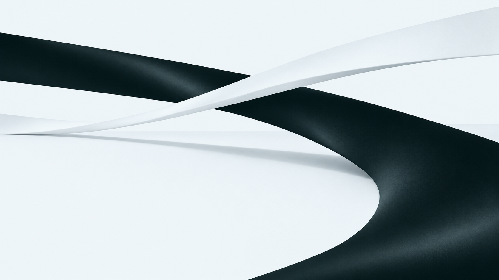

# D&G Global株式会社 ヘッダー・ヒーロー デザイン計画

作成日: 2026-11-04（日本時間）

対象: 1枚ものの企業HPのヘッダー・ヒーロー。今回は設計と検討用AI素材の作成まで。

## 1. 事業の理解と伝えること

ユーザーから共有された事業の概要:

- コンサルティング
- グローバル人材の育成
- 取引先企業の従業員への言語指導・育成
- 通訳、および商業展示会などでの同時通訳

想定する主な閲覧者は、通訳や従業員の語学・人材育成を相談したい企業担当者。これはサイト設計上の仮説であり、顧客像が詳しくわかれば調整する。

最初の画面で「言葉と人の成長を通じて、企業を支える会社」と理解でき、事業内容または相談へ進めることを目指す。対応言語、対応地域、実績、人数、資格、研修の詳細、コンサルティングの範囲は未確認。

## 2. 推奨コンセプト

**言葉が交わり、可能性がひらく。**

異なる言語・文化・考え方が出会い、次の関係や成長へ続いていくことを、画面を横断する2本の大きな帯と広い余白で表現する。帯は画面の外まで続き、奥行きによって距離や広がりを感じさせる。

グローバル感は、構図のスケール、連続性、交差、英字と日本語の整った組版で表現する。地球・地図・国旗を使わない。素材の印象はマットで静かにし、コピーには人やコミュニケーションを感じる言葉を使う。

## 3. 配色

ユーザー指定を反映した基本色の候補は2色のみ。

| 色 | 候補HEX | 用途 |
| --- | --- | --- |
| 青をわずかに含む白 | `#F4F8FA` | ページ背景、白い帯、黒いボタン内の文字 |
| 青緑をわずかに含む黒 | `#081416` | 文字、黒い帯、ボタン、罫線 |

離れて見ると白黒に見え、近くでわずかな色味に気づく程度とする。コバルトブルーなどの追加アクセント色は使わない。陰影や薄い罫線はこの2色の混色・透過で作る。通常の本文文字には黒をそのまま使い、薄さで可読性を下げない。

白を主役にし、黒を文字・帯・主要な操作部分に集約する。ボタンやリンクの区別は面・線・太さ・下線で表現する。

## 4. ヘッダー

PCの初期寸法案は高さ88px、左右余白56px前後。幅に応じて24〜64pxの範囲で可変にする。

- 左: `D&G Global株式会社` の仮の文字組み。正式ロゴがあれば差し替える。社名を省略した正式ロゴを独自に確定しない。
- 右: 「私たちについて」「事業内容」「会社概要」「お問い合わせ」。1ページ内の該当セクションへ移動する想定。
- 「お問い合わせ」は黒い面と白文字。角は0〜2pxで端正に整える。
- その他のリンクは黒文字と短い下線のホバー表現。
- 背景は白系。ヒーローの静かな上部余白と連続させる。
- スクロール後は高さを72px程度に抑えた白背景の固定ヘッダーへ移行し、細い区切り線を添える。
- 会社紹介等の下層セクションが未制作の段階では、実装時に行き先のないリンクを動作完成扱いにしない。

スマートフォンは高さ68〜72px、左右余白20〜24px。社名と「メニュー」を配置し、開いたメニューに各セクションと相談導線を置く。言語切替は翻訳ページの用意がある場合に追加する。

メニューはキーボード操作、Escapeによる閉鎖、フォーカスの管理、開閉状態の読み上げに対応する。タップ領域は44px以上を確保する。

## 5. ヒーロー

### 構図

画面全体を一つの空間として使う。背景の帯が中央上部から右下へ流れ、メインコピーは左下の明るい余白に置く。左右に独立したカラムを作らず、ビジュアル・文字・ヘッダーが同じ画面の中で成立する構図にする。

PCはヘッダーを含むファーストビューがおおむね1画面に収まる高さを目安とし、本文量や画面の高さに応じて伸びる設計。日本語の大きさは72〜96px程度から調整し、必ずコピー全体が白い余白に収まるようにする。

### コピー案（未確定）

メイン:

> 言葉を越えて、
> 可能性をひらく。

補足:

> 通訳・語学指導・グローバル人材育成を通じて、
> 人と企業が世界とつながる力を支えます。

補足文は公開前に正式なサービス表記と照合する。コンサルティングは業務範囲の確認後に事業紹介で具体化する。

主導線は「事業内容を見る ↓」。お問い合わせはヘッダーの目立つ位置に置く。ヒーロー右下に小さくスクロールを促す文字と細線を配置できるが、主導線と重複する場合は省く。

主役は日本語。英字は社名や控えめなラベルに絞り、日本の企業担当者が迷わず内容を理解できるようにする。

### タイポグラフィ

日本語はNoto Sans JPなど、読みやすく端正なゴシック体を候補とする。見出しはMedium程度で、強い太字を多用せず、大きさと余白で存在感を出す。英数字は同系統のサンセリフ体で統一する。

PCの本文は16〜18px、モバイルは15〜16pxを初期目安にする。日本語本文の行間は1.7程度。フォントファイルは必要なウェイトに絞る。

## 6. AI素材

検討用の制作画像: [hero-crossing-monochrome-v1.png](assets/hero-crossing-monochrome-v1.png)

青みの白い空間を、青緑みの黒い帯と白い帯が横断する。文字やロゴは画像に焼き込まず、実装ではHTMLとして重ねる。実際の社内や顧客、研修風景を示す素材としては扱わない。

これはアートディレクションを確認するための1点。実装時にはPCのトリミングを確認したうえで、モバイル専用の縦長構図を別途制作する。スマートフォンで単純な中央切り抜きを行うと白い文字領域が失われるため、縦構図でもコピーの余白を確保する。

画像の色と画面背景の境目が気になる場合は、端部を調整して連続させる。生成画像の明暗は基本2色に由来する階調に統一する。

生成方式と使用プロンプト: [image-generation-prompts.md](image-generation-prompts.md)

## 7. 動きの計画

| 場面 | 演出案 | 目安 |
| --- | --- | --- |
| 初回表示 | 背景は表示済みの状態から、ごく小さくスケールを整える | 約1秒、1.025→1 |
| コピー表示 | 行ごとに16px程度下からフェードイン | 各0.7秒、開始差0.12秒 |
| ヘッダー・導線 | コピーと重なる時間帯で短くフェードイン | 0.4〜0.6秒 |
| スクロール | 背景のみ最大24〜40px程度の視差移動 | PCに限定して検討 |
| リンク操作 | 下線または面の白黒反転 | 0.2〜0.3秒 |

表示演出全体は1.2秒程度で落ち着くように重ねる。画像が1枚である段階では帯の個別変形は行わず、画像全体の緩やかな移動にとどめる。スクロール固定や長いオープニングは設けない。

動きを減らす設定では登場演出・視差・慣性を抑え、静止状態で同じ情報を読めるようにする。JavaScriptが使えない場合にも本文と導線が最初から表示される構成にする。

## 8. モバイルでの構成

- 縦長のビジュアル上部に帯の交差を置き、中央から下をコピー用の白い余白にする。
- メインコピーは36〜48px程度、2行を基本に幅に応じて調整する。
- ヘッダー、コピー、補足、導線の順序を維持し、短い画面ではセクションが自然に伸びるようにする。
- モバイルは原則として標準のタッチスクロールを使い、背景の視差移動は止める。
- 320px幅、文字拡大、横向き、低い画面でも文字やボタンが切れないことを実装時に確認する。

## 9. 技術方針

| 技術 | 担当する役割 |
| --- | --- |
| Astro | ヘッダー・ヒーローのHTML、画像、メタ情報、コンポーネント構成 |
| GSAP | コピーの登場、画像の小さな移動、ScrollTriggerによるスクロール連動 |
| Lenis | PCでの控えめな慣性スクロールとセクションへの移動 |
| SCSS | 基本2色、余白、文字サイズ、メディアクエリの一元管理 |

既存package.jsonにはAstro・GSAP・Lenisがある。SCSSを使う際はSass依存を追加する。これは計画段階の記録であり、依存の追加やサイト本体の実装はまだ行っていない。

実装時の分割候補は `SiteHeader.astro`、`Hero.astro`、`styles/global.scss`、`scripts/motion.ts`。LenisとGSAPは公式の同期方式を使い、アニメーションの更新ループを重複させない。固定ヘッダー分のアンカー余白と、キーボード移動時のフォーカスも調整する。

背景は装飾画像として扱う。画像にはサイズを明示し、初期表示に必要なものを優先取得して、AVIF/WebP等への変換と適切なレスポンシブ配信を実装時に検討する。

参照した公式資料:

- [Astro Components](https://docs.astro.build/en/basics/astro-components/)
- [Astro Styles and CSS / Sass and SCSS](https://docs.astro.build/en/guides/styling/#sass-and-scss)
- [GSAP ScrollTrigger](https://gsap.com/docs/v3/Plugins/ScrollTrigger/)
- [Lenis GSAP連携](https://github.com/darkroomengineering/lenis#gsap-scrolltrigger)

## 10. 次の制作工程と現在の状態

この計画をもとに、PC・スマートフォンのヘッダーとヒーローを制作し、実際の画面で文字と帯の重なり、配色、視線の流れを調整する。その後、事業内容等の詳細を受けて1枚のHP全体へ展開する。

正式ロゴ、対応言語、会社情報、問い合わせ方法、サービスの正式名称が提供されれば反映する。未確認の実績や事業範囲を補って掲載しない。

現在の成果物は本計画書、AI素材1点、生成プロンプト記録。サイトソースの変更、ビルド、開発サーバー起動、ブラウザ検証、公開は対象外のため未実施。
